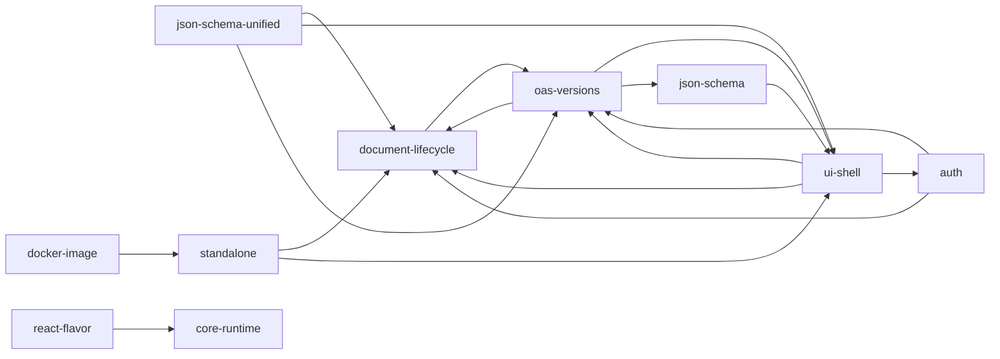

## Shape

Swagger UI is a single-page React application whose features are all **plugins** compiled into a
**System**: a Redux store with Immutable state, plus a registry of components, bound actions,
selectors, and helper `fn`s. The `SwaggerUI(options)` entry point merges the configuration,
builds the System from **presets** (ordered plugin lists) and user plugins, loads the definition,
and renders the `App` component into a DOM node. The runtime is owned by
[core-runtime](src/core/SPEC.md).

Plugins talk to each other through the System (`specSelectors`, `authActions`, `fn.execute`,
`getComponent("Name")`), not through imports. That is what lets a later plugin replace or wrap
anything an earlier one provided.

## Modules

| Module | Owns |
|---|---|
| [core-runtime](src/core/SPEC.md) | System, plugin combination, config pipeline, presets, `SwaggerUI.*` public API |
| [document-lifecycle](src/core/plugins/spec/SPEC.md) | loading, parsing, and resolving the definition; request execution; errors; runtime configs |
| [auth](src/core/plugins/auth/SPEC.md) | security-scheme state, authorization flows including OAuth2, persistence |
| [ui-shell](src/core/components/SPEC.md) | shared components, rendering, layout state, deep linking, filtering, error boundaries, sanitization |
| [oas-versions](src/core/plugins/oas3/SPEC.md) | OpenAPI 3.0 / 3.1 / 3.2 detection and per-version behaviour |
| [json-schema](src/core/plugins/json-schema-2020-12/SPEC.md) | the two schema renderers and their sample generators |
| [json-schema-unified](src/core/plugins/json-schema-unified/SPEC.md) | the opt-in unified schema view for every OpenAPI version (`unifiedJSONSchemaEnabled`) |
| [standalone](src/standalone/SPEC.md) | the standalone preset: top bar, URL picker, dark mode |
| [react-flavor](flavors/swagger-ui-react/SPEC.md) | the `swagger-ui-react` component |
| [docker-image](docker/SPEC.md) | the `swaggerapi/swagger-ui` image and its env-var config contract |

Runtime dependency edges between them. These go through the System, not imports.

Every plugin module also depends on core-runtime (edges omitted). The `document-lifecycle →
oas-versions` and `ui-shell → oas-versions` edges are why the base preset cannot render a
document on its own (see Invariants).

## Presets

- **base** (`src/core/presets/base`): the version-agnostic plugins plus the shared component
  set and the JSON Schema 5 renderer.
- **apis** (`src/core/presets/apis`, the default): base → oas3 → json-schema-2020-12 →
  json-schema-2020-12-samples → oas31 → oas32 → json-schema-unified. The newest OpenAPI version
  is always last *among the OpenAPI plugins*. json-schema-unified always comes after all of them,
  so its `Model`/`Models` wrappers stay outermost and the opt-in unified schema view
  (`unifiedJSONSchemaEnabled`) also covers versions added later. The add-oas-support
  PRESET-ORDER check enforces both.
- **standalone** (separate bundle): layered on top of apis by the user (`layout:
  "StandaloneLayout"`).

## Invariants

- **Order is semantics.** A later plugin replaces an earlier one's key. `wrapActions`,
  `wrapSelectors`, and `wrapComponents` stack, with later wrappers outermost. Presets register
  before `options.plugins`, and the inline plugin (`options.fn`/`options.components`) comes
  last.
- **apis is the smallest working preset.** base is a building block only. The spec plugin
  reads `oas3Selectors`, `isSwagger2` is defined by oas3, and `BaseLayout` reads
  `isOAS31`/`isOAS32`. This is by decision, not a defect.
- **No cross-plugin imports.** A plugin reaches another only through the System. When version
  plugins need the same code, each keeps its own copy (rule and rationale: `CLAUDE.md` →
  Cross-Plugin Import Guidelines). Code under `src/core/utils` and `src/core/components` may be
  imported. Existing exceptions: `oas3/spec-extensions/wrap-selectors.js → spec/selectors`,
  `view-legacy → view/root-injects`, `core/system.js → err/actions`, and
  `core/components/curl.jsx → request-snippets/fn`.
- **Components are looked up by name.** Use `getComponent(name[, true])` rather than `import`, so
  plugins can override them.
- **State is Immutable.** Reducers return Immutable values. Each namespace's slice defaults to
  an empty `Map`.
- **Untrusted content is sanitized** before rendering (owned by [ui-shell](src/core/components/SPEC.md)).

## Build and distribution

Webpack builds the bundles in `dist/` from `src/` (configs in `webpack/`):

| Bundle | Format | Dependencies |
|---|---|---|
| `swagger-ui.js` | UMD (`SwaggerUICore`) | external |
| `swagger-ui-bundle.js` | UMD (`SwaggerUIBundle`) | inlined |
| `swagger-ui-standalone-preset.js` | UMD | inlined |
| `swagger-ui-es-bundle-core.js` | ESM | external |
| `swagger-ui-es-bundle.js` | CommonJS2 (despite the name) | inlined |
| `swagger-ui.css` | from `src/style/main.scss` (SCSS) plus `src/style/tailwind.css` (Tailwind v4, isolated per [ui-shell](src/core/components/SPEC.md)) | — |

The root `package.json` `exports` map selects among them by environment (browser vs. node,
import vs. require).

| Channel | Produced by |
|---|---|
| npm `swagger-ui` | the release workflow (semantic-release, manually dispatched on `main`) |
| `dist/` in git | the same workflow commits the built `dist/*` back to `main`. Packagist/composer consumers and people who copy `/dist` from GitHub read it from the repo |
| npm `swagger-ui-dist` | `swagger-ui-dist-package/deploy.sh` repackages the `dist` artifact; it has no dependencies |
| npm `swagger-ui-react` | see [react-flavor](flavors/swagger-ui-react/SPEC.md) |
| Docker `swaggerapi/swagger-ui` | see [docker-image](docker/SPEC.md) |
| Packagist | a webhook ping after each release; `composer.json` is metadata only |

## Quality gates

CI (`.github/workflows/nodejs.yml`, on `main`/`next`) runs ESLint (errors), Playwright spec
type-checking, Jest unit tests (jsdom, `test/unit`), the build, the artifact tests
(`test/build-artifacts`: bundle exports and the Tailwind isolation of `swagger-ui.css`), and Playwright end-to-end tests (`test/e2e-playwright`, 4 shards). Code
conventions (TypeScript for new files, no semicolons, `@prettier` pragma, Conventional Commits)
live in `CLAUDE.md`.
